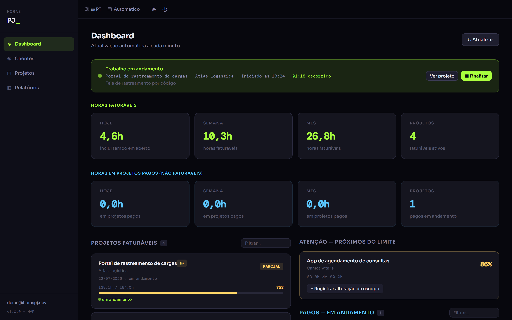
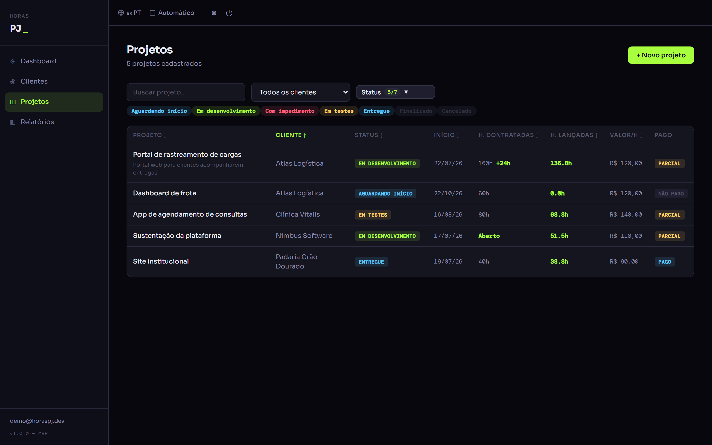
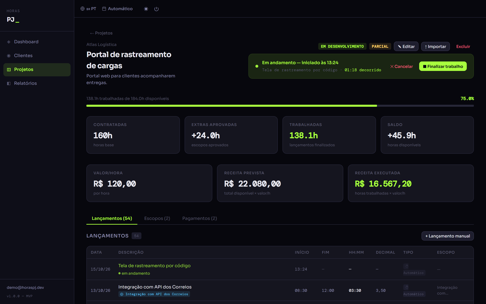
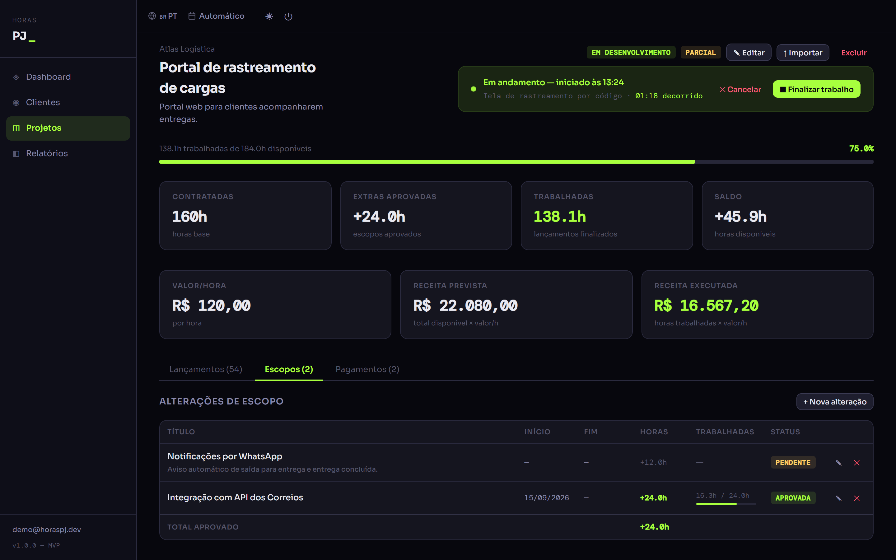
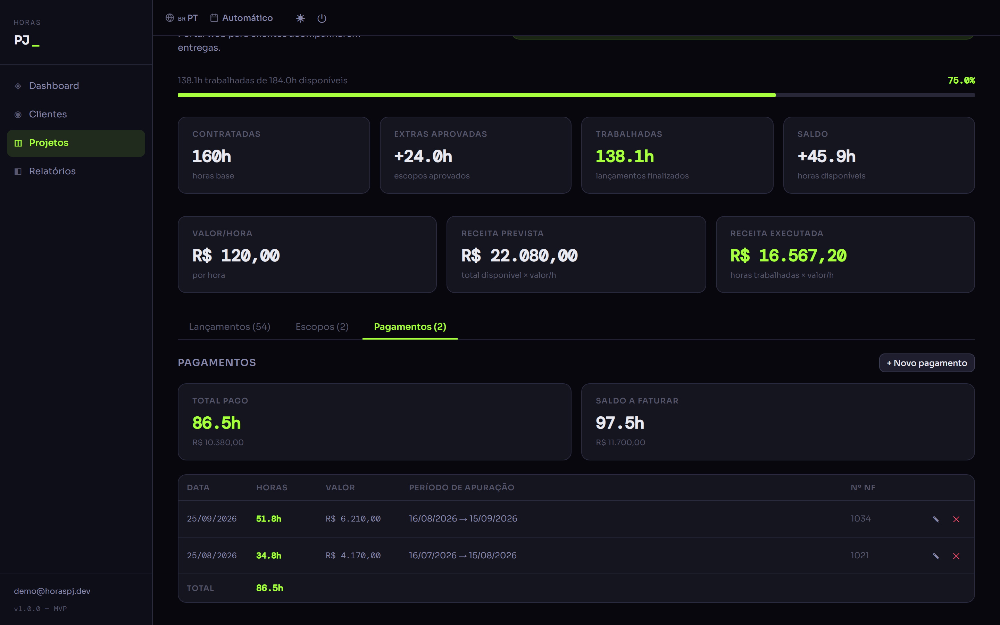
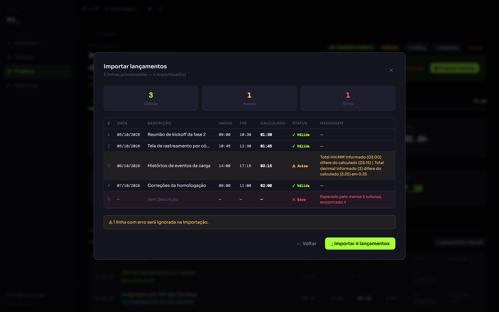
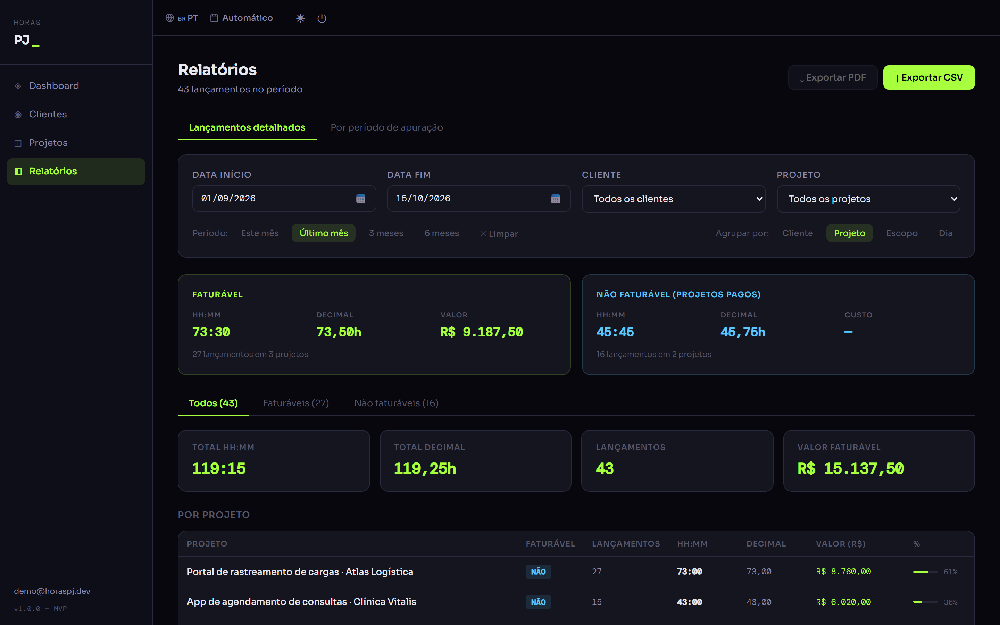
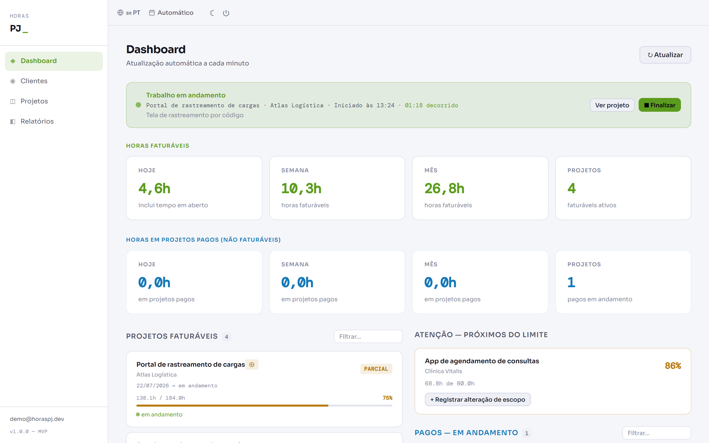
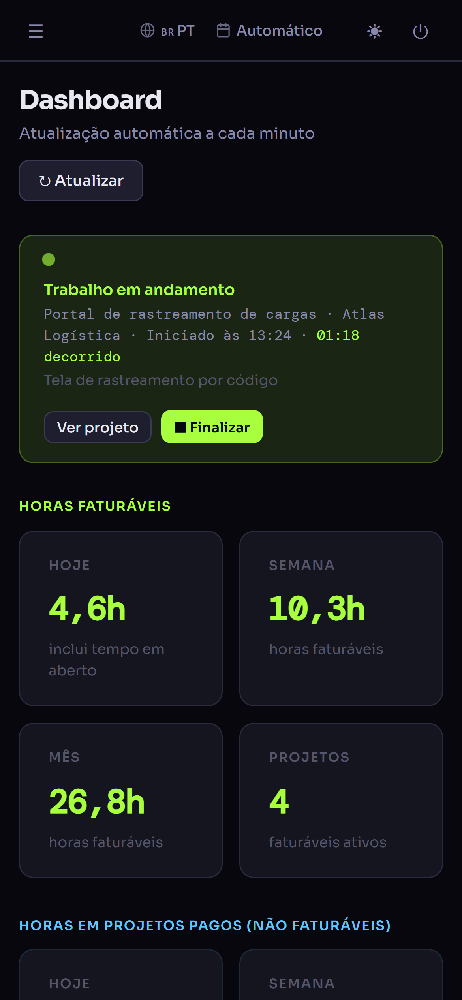
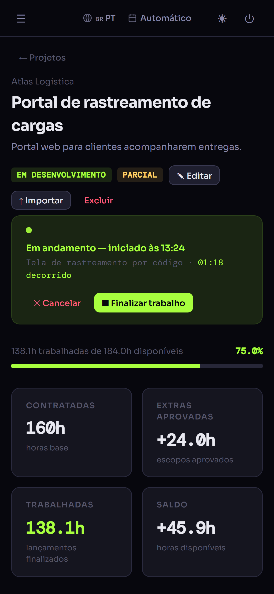

# Horas PJ

**Controle de horas para quem trabalha como PJ ou freelancer.** Com ele você bate o ponto em um clique e acompanha quanto consumiu de cada contrato. Também mostra o que já foi pago e o que ainda falta faturar em cada período de apuração. Substitui a planilha sem perder a importação dela.



> Os dados de todas as imagens são **fictícios**, gerados por `npm run seed:demo` (ver [Dados de demonstração](#dados-de-demonstração)).

## O que dá para fazer

- **Controle de ponto.** Iniciar e finalizar com um clique, com um trabalho em andamento por vez. Se você trocar de projeto com um ponto aberto, o app oferece encerrar o anterior. A última descrição e o último escopo de cada projeto já vêm preenchidos.
- **Dashboard.** Mostra as horas faturáveis e as já pagas (hoje, semana e mês), o trabalho em andamento com o tempo decorrido e os projetos a faturar com barra de consumo. Avisa quando um projeto passa de **80% do contratado**.
- **Projetos com horas contratadas ou abertas.** Quem tem contrato fechado tem saldo e progresso. Sustentação ou banco de horas trabalha sem limite. Para cada projeto aparecem a receita prevista e a executada.
- **Alterações de escopo.** Ficam pendentes, aprovadas ou canceladas, e só as aprovadas aumentam o limite. Também há escopos de "horas livres", para levantamentos e estimativas.
- **Pagamentos por período de apuração (16 a 15).** São parciais, com número de NF. As horas mais antigas são cobertas primeiro, e cada lançamento sai marcado como faturável ou não. Projetos antigos podem ser **regularizados** com um clique.
- **Importação de planilha.** Basta colar do Excel ou do Google Sheets. Antes de gravar, uma pré-visualização marca cada linha como válida, com aviso ou com erro.
- **Relatórios.** Filtros por período, cliente e projeto, agrupamento por cliente, projeto, escopo ou dia, uma visão por período de apuração e exportação em **CSV e PDF**.
- **pt · en · es**, tema claro e escuro, formato de data configurável e layout para celular.

## Galeria

| | |
|---|---|
|  |  |
| **Projetos**: status, horas contratadas e lançadas, situação de pagamento | **Detalhe do projeto**: ponto em andamento, consumo e receita |
|  |  |
| **Alterações de escopo**: aprovadas somam ao limite | **Pagamentos** por período de apuração, com NF |
|  |  |
| **Importação de planilha** com validação linha a linha | **Relatórios**: faturável e não faturável, CSV e PDF |

<p align="center">
  
</p>

<p align="center">
  
  &nbsp;&nbsp;
  
</p>

## Decisões de produto e engenharia que valem destacar

- **Uma fonte para cada regra.** A faturabilidade fica em `backend/src/utils/faturamento.ts`. O backend devolve o campo `faturavel` já calculado, e dashboard e relatórios só o consomem. Os cálculos de tempo ficam em `utils/tempo.ts`, um no backend e outro no frontend. Detalhes em [`docs/domain-logic.md`](docs/domain-logic.md).
- **Pagamento por período, não por demanda.** A NF cobre um total de horas, e as horas mais antigas são abatidas primeiro, como acontece no faturamento real de PJ. A regularização gera um pagamento rastreável e reversível; ela não "apaga" saldo.
- **"Horas abertas" é um estado válido.** Um projeto sem `horasContratadas` não é um cadastro incompleto: é sustentação ou banco de horas, e a interface trata esse caso à parte.
- **Multi-tenant por construção.** Toda entidade carrega `tenantId`, e a checagem de posse fica centralizada no repositório (`findByIdAndTenant`, `updateForTenant`…), nunca espalhada pelos services. O `tenantId` vem sempre da sessão, nunca da requisição.
- **Exclusão em cascata transacional.** Apagar um projeto remove escopos, lançamentos e pagamentos numa transação MongoDB.
- **Fuso fixo.** O servidor roda em `America/Sao_Paulo`, então "hoje" e "agora" não mudam conforme a hospedagem.
- **Login Google com sessão própria.** O ID token é validado no backend (assinatura, audience e `email_verified`), e a sessão é um JWT em cookie httpOnly. Em produção, um proxy same-origin no Cloudflare Pages deixa o cookie first-party e faz funcionar no Safari/iOS.

## Stack

| Camada | Tecnologias |
|---|---|
| Frontend | React 18, TypeScript, Vite, React Router, i18next, jsPDF; CSS próprio com variáveis (sem biblioteca de UI) |
| Backend | Node.js, TypeScript, Express, MongoDB Atlas (driver nativo, sem ODM), google-auth-library, JWT |
| Arquitetura | `routes → controllers → services → repositories`; o frontend só fala com a API REST |
| Testes | Vitest |
| Deploy | Cloudflare Pages (frontend + proxy `/api`) e Render (backend) |

## Rodando localmente

São dois pacotes independentes, cada um com seu `package.json`. Requer Node.js 18+ e uma base MongoDB (o Atlas M0 gratuito serve).

```bash
cd backend && npm install && cp .env.example .env    # preencha MONGODB_URI, JWT_SECRET, GOOGLE_CLIENT_ID
cd frontend && npm install
```

Em dois terminais:

```bash
cd backend && npm run dev     # API em http://localhost:3001
cd frontend && npm run dev    # app em http://localhost:5173 (proxy /api → :3001)
```

O login usa o Google. Quem pode entrar é definido no **Google Cloud Console**, na OAuth consent screen: test users no modo "Testing" ou domínio no modo "Internal". Cada e-mail que entra vira um workspace isolado.

### Dados de demonstração

Para ver o app cheio sem usar dados reais, use um banco **separado** (o nome precisa conter `demo`):

```bash
cd backend
MONGODB_DB_NAME=horas-pj-demo npm run seed:demo
```

O script apaga e recria, só nesse banco, cerca de 3 meses de trabalho fictício do tenant `demo@horaspj.dev`. São quatro clientes e cinco projetos: com horas contratadas, com horas abertas, próximo do limite, aguardando início e um regularizado. Também entram escopos aprovado, pendente e de horas livres, pagamentos por período de apuração e um ponto em andamento. O script se recusa a rodar em banco sem `demo` no nome e pode ser repetido sem duplicar dados. Para navegar, suba o backend com o mesmo `MONGODB_DB_NAME` (configuração `backend-demo` em `.claude/launch.json`).

### Variáveis de ambiente

**`backend/.env`** (veja `backend/.env.example`):

| Variável | Padrão | Uso |
|---|---|---|
| `PORT` | `3001` | Porta do Express |
| `MONGODB_URI` | — (obrigatória) | Connection string do MongoDB |
| `MONGODB_DB_NAME` | `horas-pj` | Nome do banco |
| `MONGODB_DB_NAME_TEST` | `<banco>-test` | Banco usado com `NODE_ENV=test`. Precisa ser diferente do de produção |
| `GOOGLE_CLIENT_ID` | — (obrigatória) | OAuth Client ID do Google |
| `JWT_SECRET` | — (obrigatória) | Segredo que assina o cookie de sessão |
| `CORS_ORIGIN` | `http://localhost:5173` | Uma ou mais origens do frontend, separadas por vírgula |

**Cloudflare Pages**: `API_ORIGIN` é a URL pública do backend, usada pelo proxy `frontend/functions/api/[[path]].ts`.

### Testes e build

```bash
cd backend  && npx tsc --noEmit && npm test && npm run build
cd frontend && npx tsc --noEmit && npm run build
```

## Documentação

- [`docs/plano-melhorias.md`](docs/plano-melhorias.md): plano de evolução (camadas, segurança, testes, LGPD), com decisões e andamento de cada entrega
- [`docs/domain-logic.md`](docs/domain-logic.md): entidades e regras de negócio (saldo, escopos, faturabilidade, pagamentos, ponto, importação)
- [`docs/api.md`](docs/api.md): endpoints do backend
- [`CHANGELOG.md`](CHANGELOG.md): histórico de mudanças

## Estrutura

```
backend/src/
  routes/          # rotas Express (/api/...)
  controllers/     # traduzem HTTP ↔ service
  services/        # regras de negócio por entidade
  repositories/    # MongoRepository genérico + conexão/índices (única camada que toca o banco)
  utils/           # tempo.ts (horas/datas), faturamento.ts (fonte única de faturabilidade)
  middleware/      # autenticação (cookie de sessão)
  scripts/         # seed-demo
frontend/src/
  pages/           # Dashboard, Clientes, Projetos (lista e detalhe), Relatórios, Login
  components/      # layout, controle de ponto, tabela de lançamentos, importação, inputs
  contexts/        # autenticação, tema, preferências
  i18n/            # pt, en, es
frontend/functions/api/   # proxy same-origin do Cloudflare Pages
docs/              # plano, lógica de domínio, API, prints
```
